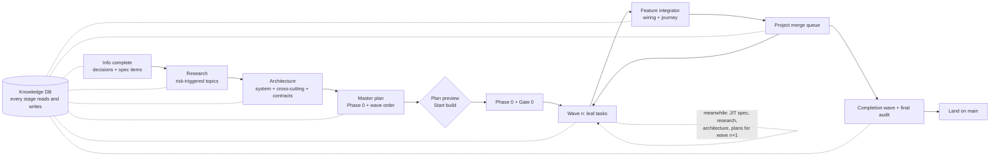

# Build pipeline: from complete information to a finished app

This is the assembly line. It starts when discovery and spec expansion say the information is complete and ends when every requirement has passing evidence on `harness/integration` and the developer lands it on `main`. Every stage reads from and writes to one versioned knowledge database; Markdown and Mermaid files are generated views of it. Every handoff is a typed, versioned packet, never a transcript. Diagram: [build-pipeline.svg](build-pipeline.svg) · [editable Mermaid](build-pipeline.mmd). Research: [assembly-line pipeline](research/assembly-line-pipeline.md).

## Decisions in plain words

1. **One database from the first answer.** The knowledge database isn't a stage after architecture; discovery, spec, research, architecture, plans, checks and progress all live in it from the start. Files are exports for people.
2. **Document counts follow the project.** A sharding rule decides how many research, architecture and plan documents exist. A small CLI gets a handful; a SaaS app gets hundreds.
3. **Upfront only what crosses boundaries; the rest one wave ahead.** Everything Phase 0 or more than one feature depends on, everything hard to reverse and everything that needs the developer is settled before building. Feature-internal detail is produced while the previous wave codes.
4. **Paperwork has a budget.** Research, architecture, planning and auditing together are capped (default 20% of the project budget or plan share), shown before starting.
5. **Code checks coverage, not a model.** Graph compile refuses a plan where any requirement lacks a task and a check ([completeness gate](completeness-gate.md)).
6. **Every commit that enters a shared branch is verified,** including the integrator's own merges and wiring.
7. **Late cross-feature needs go through a contract change request,** fast-pathed when the change is additive.

## Overview



## Stage 0 · Information complete

Discovery ([project discovery](project-discovery.md), [discovery depth](discovery-depth-and-catalog.md)) plus project-wide [spec expansion](spec-expansion.md). Exit: every required cell has a valid basis, zero unresolved contradictions, zero critical questions. Feature-internal cells that need no developer input may be filled just in time (below); the expander's first pass still identifies, upfront, every cell that *will* need the developer, so no surprise questions appear mid-build.

## Stage A · Research

**Topic generator (code).** Research topics are generated from the decision graph, not chosen freely:

| Topic | Generated when | Example |
|---|---|---|
| Stack compatibility | Always (one) | Next.js 15 + Prisma 6 + Auth.js versions that work together on Windows and Linux |
| Library | A chosen library at a major version isn't in the research cache | `react-to-print@3`: printing in Safari, CSS print rules |
| External service | Any third-party API | Payment provider test mode, webhook signature checks |
| Cross-cutting risk | A risk tag is triggered (auth, money, time, concurrency, personal data, files, real time) | Time zones and daylight-saving changes for cutoff rules |
| Feature risk | A feature's spec items carry a risk tag no other topic covers | Printing large lists |

Features made only of standard work on a researched stack get **no** feature research.

**Researcher output** (`feature-researcher@1`, read-only, browsing through the doc fetcher only) is a structured record per topic:

```yaml
id: RS-F12-print
topic: Printing kitchen totals from the browser
claims:
  - id: RF-031
    text: "Safari ignores CSS page-break-inside on table rows in some versions."
    source: {url: "https://…", fetched: 2026-11-16, quote: "…"}
    confidence: medium
constraints: [ {id: RC-08, text: "Use @media print with explicit page breaks between groups"} ]
edge_cases:  [ {id: EC-114, text: "List longer than one page splits a dish group"} ]
failure_modes: [ … ]
open_contradictions: []          # must be empty to pass
```

**Validation gate (code, then a small model):** every generated topic has a record; `open_contradictions` is empty (a real product conflict becomes a developer question); and each claim passes the checks below. Facts, constraints and edge cases become database rows with IDs.

| Trap | Defense |
|---|---|
| Documentation rendered by JavaScript (static fetch returns an empty shell) | The doc fetcher renders the page in a headless browser when the static text is too short or lacks the expected structure, then extracts text with tables and code blocks preserved |
| Quotes across tables and code blocks don't match exactly | Matching is token-based and ignores whitespace, punctuation and markup, with a minimum quote length; the matched span is stored |
| Docs for a different version (a v4 page, an old banner, a version switcher) | The fetcher records the page's detected version (URL path, version selector, headings). A claim is valid only if that version matches the project's installed **major.minor** |
| Quote true but out of context (“not supported” referring to something else) | `entailment-checker@1` reads the quote with its surrounding paragraph and confirms it supports the claim |
| API claims | Checked against the installed package's own type definitions or source where possible: the symbol, option or signature must exist at the installed version |

**Research cache.** Facts are keyed by package and **major.minor**, documentation URL and page version, and reused across this machine's projects for up to 90 days. A lockfile change to a different minor version invalidates them.

## Stage B · Architecture

| Author | Level | Produces |
|---|---|---|
| `system-architect@1` | Manager | System overview, components and boundaries, data model (all entities, relations, ownership), inter-feature contracts, cross-cutting rules with scope predicates, conventions, environment manifest |
| `feature-architect@1` | Senior, one per feature, just in time | Feature flows, screen specs, state machines, internal contracts, how each spec item and edge case is handled |

**Consistency gate (code, no model):**

- Every spec item and edge case links to an architecture node or contract.
- Every contract has at least one producer and one consumer.
- Every entity has one owner; every shared file has one owner.
- Cross-cutting rules have scope predicates; feature rules matching a cross-cutting category are classified ([rule hoisting](knowledge-slicing.md#cross-cutting-rules-reach-every-task-they-apply-to)).
- Every Mermaid view parses, and its node IDs exist in the database.
- No dangling references.

## The knowledge database and its exports

Decisions, spec items, research facts, edge cases, architecture nodes, contracts, rules, plans, tasks, checks, waivers and contract change requests are **node kinds** in one versioned `nodes` table, related by typed edges. Runtime state lives in its own tables (`task_runtime`, `attempts`, `check_results`, `read_sets`, `ref_leases`, `artifacts`), and requirements, coverage links, waivers and feature progress are views or trigger-maintained rollups. Every knowledge record has a stable ID, version and content hash. The complete schema is in [database design](database-design.md).

Generated views, regenerated per published revision into `<project>/.harness/views/` (excluded from Git locally) and the `harness-state` branch. Edits to these files are imported as reviewed proposals ([knowledge database](knowledge-database.md#1-direct-edits-to-the-generated-markdown)):

```
.harness/views/
├── research/stack.md · research/features/F12-print.md · research/services/payments.md
├── arch/system-overview.md + .mmd · arch/data/schema.md + er.mmd
├── arch/contracts/kitchen-totals@1.md · arch/cross-cutting/time.md
├── arch/features/F12/architecture.md + flow.mmd + states.mmd
├── plans/master-plan.md + wave-dag.mmd
└── plans/features/F12/plan.md · tasks/T07.md · oracles/AC-31.yaml (visible parts only)
```

### Sharding rule (how many documents)

| Document | One per | Split when | Merge when |
|---|---|---|---|
| Research | Generated topic (above) | Over ~300 lines or more than ~15 claims | Under ~40 lines, into the stack note |
| Data model | Bounded context (a cluster of related entities, about 8–12) | More than ~12 entities | — |
| Contract | Inter-feature interface | Never; contracts stay small | — |
| Cross-cutting | Triggered concern | Over ~300 lines | Under ~40 lines, into system overview |
| Feature architecture | Feature | Over ~300 lines or more than ~20 spec items in one flow → split by sub-flow | — |
| Plan | Feature, plus one master plan | — | — |
| Task file | Task (tasks themselves are sized by the planner's task-size limits) | — | — |

| Project | Research | Architecture | Plan and task files |
|---|---|---|---|
| 3-command CLI | 1–2 | 4–6 | ~10 |
| Kitchen app (4 features) | ~6 | ~14 | ~35 |
| SaaS (20 features) | ~35 | ~80 | ~300 |

## Stage C · Planning

`master-planner@1` (Manager) writes the master plan: Phase 0 recipes ([planning and crew](planning-and-crew.md#shared-foundations-phase-0)), feature order as a wave graph, coarse estimates. `feature-planner@1` (Senior, per feature, just in time) writes task files, visible acceptance examples, check slots and the wiring brief. **`oracle-author@1`** (a different model family where available, without seeing the task split) then writes the held-back cases and scoring rubrics for those slots; they are sealed before graph compile, so the planner's blind spots aren't repeated in the hidden tests.

**Graph compile (code):** no cycles; no two tasks own the same path (sweeps excepted, see [sweeps](investigations-and-sweeps.md#sweeps)); **no two owners of the same logical name** (below); task sizes within limits; **traceability invariants hold** (every requirement has a task and a check); every task's Must packet fits its model ([knowledge slicing](knowledge-slicing.md)). Failure returns the exact list to the planner.

### Resource-name registry

Two feature architects working in parallel can invent the same route, table index, environment variable or storage key in different files, which path ownership doesn't catch. Every such name is registered in the `names` table with kind, value and owner:

| Kind | Examples |
|---|---|
| HTTP route, page route | `/api/kitchen/export`, `/kitchen` |
| Database table, column (table-qualified), index, constraint | `orders.pickup_slot`, `idx_orders_day` |
| Environment variable | `STRIPE_WEBHOOK_SECRET` |
| Browser storage key, cookie name, cache key prefix | `kitchen:lastView`, `kitchen:*` |
| Event, queue and job names | `order.locked` |
| Permission, feature flag, translation key namespace, CLI command | `orders.edit`, `kitchen.*` |

Rules:

1. System architecture allocates each feature a **prefix** per kind (`/api/kitchen/*`, `kitchen:` for keys). Names inside a feature's prefix are its own; shared names (an env var used by two features) belong to the project integrator.
2. Graph compile rejects duplicate names and overlapping patterns (a parameterized route that would shadow another feature's route).
3. The static audit extracts actual names from code (route table, environment reads, migration files, storage key literals) and fails any unregistered or foreign-owned name, so drift between plan and code is caught at the task.

## Upfront versus just in time

An item is settled **upfront** (before Phase 0) if any of these is true:

1. Phase 0 or more than one feature consumes it (stack, data model and ownership, inter-feature contracts, roles and permissions, cross-cutting rules, conventions, design tokens).
2. It is hard to reverse (database engine, auth provider, hosting).
3. It needs the developer (any spec cell classified *asked*).
4. It materially changes cost or time estimates.

Everything else is produced **just in time, one wave ahead**: feature-internal spec cells, feature research, feature architecture, task files and oracles. While wave *n* codes, the planners prepare wave *n + 1* using the latest accepted code as input, which is also fresher than anything written days earlier.

### What must be locked upfront

`system-architect@1` locks the **skeleton**; just-in-time work may only **add** to it.

| Area | Locked upfront | Allowed later without a contract change request | Needs a change request (breaking) |
|---|---|---|---|
| Entities | Every entity's name, key, owner feature, relations between entities, fields read by Phase 0 or by more than one feature | New nullable or defaulted columns on an entity the feature owns; new indexes; new tables owned by the feature | Renaming or removing anything; changing a type; new required fields on a shared entity; new relations to another feature's entity |
| Contracts between features | Operations, shapes, error codes | New optional fields; new operations owned by the producer | Changing or removing anything consumed |
| Routes and names | Top-level route areas and per-feature name prefixes (see the [name registry](#resource-name-registry)) | New names inside the feature's prefixes | Names outside the feature's prefixes |
| Roles and permissions | Roles and the permission matrix for shared entities | Permissions for entities the feature owns | Changes to shared permissions |
| Cross-cutting rules, conventions, design tokens, stack | All | New feature-local rules (classified by the consistency gate) | Any change |

So P0.3 builds the skeleton schema, not every column ([planning and crew](planning-and-crew.md#shared-foundations-phase-0)). Additive columns are migration intents owned by the feature and ordered by the project integrator. The plan preview shows Phase 0 and wave 1 as planned and later waves as projected ranges.

### When just-in-time work needs the developer

Just-in-time research can still uncover a real product choice (“Safari can't print grouped tables cleanly: download a PDF instead, or drop grouping?”). Such a question:

1. Goes to the inbox with a recommendation and a **needed-by** time: when wave *n + 1* will want to start that feature.
2. Holds only the tasks it affects. Other features of the next wave are planned and start normally.
3. Is answered by Autopilot only if the developer delegated that category and it isn't must-ask.
4. If unanswered by the needed-by time, the scheduler starts other ready work first. The feature waits; nothing is guessed.

Just-in-time planning starts early enough that these questions usually arrive while the previous wave is still coding.

```
time ─────────────────────────────────────────────────────────────────▶
Upfront:  spec(project) · research(stack, risks) · arch(system) · master plan
Phase 0:            ████████
Wave 1 code:                  ██████████████
Wave 2 JIT docs:              ░░░░░░                (in parallel with wave 1)
Wave 2 code:                                ██████████████
Wave 3 JIT docs:                            ░░░░░░
```

## Stage D · Execution order

1. **Phase 0.** P0.1 scaffold alone, then P0.2–P0.8 in parallel. **Gate 0** on `harness/integration`: build, lint, type check, migration on an empty database, smoke test, style guide renders, CI workflow green locally.
2. **Wave 1.** Features whose dependencies are only Phase 0. Because contracts are frozen, producer, consumer and data tasks inside a feature start together. Tasks grounded only in explicit facts dispatch first.
3. **Feature integration.** When every leaf task of a feature has been squashed onto its branch (`LEAVES_MERGED`), its integrator runs the wiring task and the feature journey on that branch.
4. **Wave 2 and later.** Features depending on earlier features unlock when those reach `DONE`.
5. **Completion wave.** Cross-feature journeys from the spec, full regression, accessibility across all screens, dependency and secret audit, performance checks named in the spec, then the final audit.

## State machines

### Task

| State | Meaning | Next |
|---|---|---|
| `DRAFTED` | Planned, not published | `READY` on publish |
| `READY` | Dependencies accepted, budget reservable | `LEASED` |
| `LEASED` | Attempt and worktree created | `CODING` |
| `CODING` | Worker active | `STATIC_AUDIT` on submit · `WAITING_INPUT` · `PARKED` (a hold pauses it without changing state) |
| `STATIC_AUDIT` | Deterministic scans | `CLEAN_VERIFY` · back to `CODING` with findings |
| `CLEAN_VERIFY` | Locked checks in a clean environment | `ACCEPTED` · `CODING` (hint ladder) · `ESCALATED` |
| `ACCEPTED` | Verified at current versions | `MERGED_TO_FEATURE` · `SUPERSEDED` if a revision invalidates it |
| `MERGED_TO_FEATURE` | Squashed onto the feature branch | — |
| `WAITING_INPUT` | `AskOwner`, human step or contract change request | Back to `CODING` |
| *Held* (a property, not a state) | One or more rows in `task_holds` (user pause, requirement change, budget), each reason separate; a held task keeps its state, pauses at the next boundary and can't be claimed | Continues when its last hold row is removed |
| `PARKED` | Stopped at a checkpoint (limit, quit, update) | `READY` on resume |
| `ESCALATED` | Moved up a level, or to its author | `READY` with a new attempt |
| `EXHAUSTED` | Retry budget used without progress | Owner or developer decides: revise brief, fix by hand, waive |
| `HUMAN_OWNED` | Developer fixing it | `STATIC_AUDIT` on “I'm done” |
| `SUPERSEDED` / `CANCELLED` | Replaced by a revision / removed from scope | — |

### Feature

`PLANNED → JIT_READY → IN_WAVE → LEAVES_MERGED → WIRED → JOURNEY_PASSED → QUEUED_FOR_MERGE → MERGED → DONE`, with side states `BLOCKED` (contract change request or human step), `REOPENED` (revision), `DEFERRED`, `ABANDONED`. Stored in `feature_runtime` with transitions as statements in [queries.sql](schema/queries.sql) (for example `advance_feature_leaves_merged`, which fires only when every leaf task is `MERGED_TO_FEATURE`). `FeatureCompleted` is emitted on entering `DONE`; other documents that say “feature done” mean this state.

**A feature is `DONE` only when code verifies all of:**

1. Every task of the feature is `MERGED_TO_FEATURE` at current brief and contract versions (or cancelled or superseded by a revision).
2. Every requirement and edge case linked to the feature has a passing check (no `fail`, `skip` or `missing`), or an approved waiver.
3. The static audit is clean on all of the feature's paths, including the integrator's commits.
4. The feature journey passed at the real entry point in a clean environment.
5. The feature merged onto `harness/integration` and the regression suites of all earlier `DONE` features passed on the merged result.
6. For features with screens: no critical accessibility or layout findings.
7. No open contract change requests from or to this feature.

Only then does the kernel emit `FeatureCompleted(F)`, unlocking dependent features.

### Project

`DISCOVERY → SPEC_COMPLETE → UPFRONT_DOCS → PREVIEW → PHASE0 → WAVES → COMPLETION → READY_TO_LAND → LANDED → (SHIPPING)`, stored as the single row of `project_runtime`; pausing is a flag on that row, not a state.

## Git: branches, handoffs and merges

| Ref | Owner | Rule |
|---|---|---|
| `main` (developer's branch) | Developer | Touched only by a visible landing |
| `harness/integration` | Project integrator | Always green; advanced only by the merge queue with a compare-and-swap update |
| `harness/f/<feature>` | Feature integrator: the integration role held by the feature plan's author, transferable by lease succession; it acts through `feature-integrator@1` | Created from integration when the feature's wave opens |
| `harness/t/<task>/<attempt>` | Attempt lease | From the feature branch (Phase 0 tasks: from integration) |
| `harness/s/<sweep>` | Sweep | From integration; lands like a feature |

### Leaf → feature

1. Worker calls `harness.submit_candidate()`; static audit and clean verification pass.
2. The kernel compiles a **merge instruction packet** (schema below).
3. Pre-flight `git merge-tree --write-tree` against the current feature branch, in memory.
4. **Clean:** the attempt's commits are squashed into one commit on the feature branch with trailers `Harness-Feature`, `Harness-Task`, `Harness-Checks`. Per-task commits make a single task easy to revert.
5. **Conflict:** the integrator gets only the conflicting hunks, both tasks' briefs and the contract; it resolves on a fresh worktree; then **both tasks' checks rerun** on the result.

6. **Post-merge smoke check after every leaf merge:** incremental type check, build of the affected packages and the merged tasks' fast checks (seconds to a minute). The previous feature-branch state was green, so a red result is caused by the leaf just merged. That squash commit is reverted automatically and the break goes to the feature integrator with the error (a “merge-induced break”: two leaves that are each correct but incompatible, such as one narrowing a helper the other uses), not back to a worker blindly. When many leaves queue up, they can be merged in a batch with one check; a red batch is bisected by commit.

Workers never edit shared registries (routes, barrel exports, lockfile, schema index). The `wiring_needs` in their merge instruction packets are **declarations**: the kernel appends them to the feature's single wiring task brief, and the integrator applies all of them once, inside that wiring task's attempt and its write scope (the shared files). Leaf squashes therefore never touch shared files, nothing is applied twice, and the wiring task's journey can fail before wiring and pass after (red before green). Dependency and migration intents are consumed the same way.

### Feature → integration (project merge queue)

1. One feature at a time.
2. Merge the latest integration into the feature branch in a fresh merge worktree (`merge-tree` first).
3. Semantic cross-feature conflicts (renamed helper, two migrations with the same order) go to the project integrator with both contracts and the diff.
4. **Combined gate:** this feature's journey, cross-feature tests touching it, regression suites of all `DONE` features, project smoke test.
5. Advance with `git update-ref refs/heads/harness/integration <new> <expected-old>`; if integration moved, repeat from step 2.
6. Feature lands as a **merge commit** (no fast-forward), so a whole feature can later be reverted in one step ([undo](stops-undo-and-reentry.md#undoing-a-feature-after-it-merged)).

**Migrations** are named with a timestamp plus a short hash, never a sequence number, so two features can't both create `0004`. The integrator orders them at merge time and a migration lint rejects conflicting operations on the same table.

### Hard question: keeping feature branches fresh

Feature branches **don't auto-rebase while leaves run**. Running attempts keep their base; that avoids thrashing workers. Instead:

| Trigger | Action |
|---|---|
| A contract the feature consumes changed on integration | Mandatory sync at the next safe point (between two leaf merges), done by the integrator in a fresh worktree as a merge (not a rebase) |
| `merge-tree` predicts a conflict between integration and the feature branch | Early sync by the integrator, before more leaves pile up |
| Neither | Sync only at the feature's merge-queue turn, or when the feature branch is idle and integration has moved by at least one feature |

New attempts start from the synced feature branch; attempts already running are merged onto it when they finish. Keeping waves short (a feature takes hours, not weeks) is what keeps this cheap.

### Hard question: bugs created by the integrator

The integrator is not trusted more than a worker:

- Wiring is a task with a brief and a journey check written **before** wiring; the journey must fail before wiring (red-before-green) and pass after.
- Every integrator commit (wiring, conflict resolution, migration ordering) goes through the static audit.
- Conflict resolutions rerun both tasks' checks; feature merges rerun the regression suites.
- The integrator's write scope is the conflict hunks plus declared shared files; anything else in its diff is rejected.

### Hard question: late cross-feature coupling

When F14 discovers that F12's already-merged `orders` table lacks a column it needs:

1. F14's worker asks its owner; the F14 planner files a **contract change request** (schema below) to the owner of the table: data model and shared contracts belong to the project integrator, not to F12.
2. Code classifies the change by diffing schemas:

| Class | Examples | Path |
|---|---|---|
| **Additive** | New nullable column, new optional field, new endpoint | Fast path: a small migration task owned by the data owner; only checks touching that table or contract are re-run for F12; F14 waits only on this task |
| **Breaking** | Rename, type change, removed field, new required field | Full revision through the project planner; affected features reopen; developer asked if behavior changes |

3. F14 never issues the migration itself.

## Economics: paperwork budget

| Phase | Default share of project budget |
|---|---|
| Spec expansion | 3% |
| Research | 5% |
| Architecture | 6% |
| Planning | 4% |
| Completion audit | 2% |
| **Cap** | **20%** (typical projects land at 8–15%) |

- Shown in the plan estimate before anything runs, in dollars or plan share.
- **Reserved per wave.** At planning, the cap is split into an upfront envelope and one envelope per wave, proportional to projected wave size, and reserved in the ledger as separate budgets. Coding retries spend the coding budget, never paperwork envelopes, so retries in wave 1 can't starve wave 3's planning. Unused paperwork rolls forward; borrowing from a later wave's envelope needs the developer's approval.
- If the projection exceeds the cap: research only risk-triggered topics, lower levels for feature architects, skip optional semantic contradiction checks, or ask to raise the cap.
- On plan connections, paperwork runs through the same pacer as coding; research calls run in parallel on Mid models; system architecture is the only Manager-heavy step.
- Stable prompt prefixes (kernel instructions first, task-specific content last) maximize providers' cached-input discounts.
- The research cache and just-in-time planning keep paperwork from being paid twice or for features that get cut.

## Core message schemas

All packets are JSON validated against versioned schemas; abridged here.

**Task packet** (pushed brief)

```json
{ "schema": "task-packet@1", "task": "T07", "attempt": 2, "epoch": 5, "brief_version": 3,
  "base": {"branch": "harness/f/F12", "commit": "4c1e…"},
  "goal": "…", "write_scope": ["src/app/kitchen/**", "tests/kitchen/print.*"],
  "must": [{"id": "SI-212", "v": 2, "text": "…"}, {"id": "X-03", "v": 1, "text": "…"}],
  "contracts": [{"id": "kitchen-totals", "v": 1, "role": "consume"}],
  "checks_visible": ["AC-31", "UI-12"], "checks_hidden_count": 1,
  "should": [ … ], "skills": [{"id": "accessible-ui", "digest": "sha256:…"}],
  "tools": ["edit", "harness.run", "kb.*", "harness.ask_owner", "harness.flag_blocked"],
  "budget": {"usd": 0.40, "allowance": {"chatgpt-personal": 0.6}}, "limits": {"wall_min": 30} }
```

**Candidate submission**

```json
{ "schema": "candidate@1", "task": "T07", "attempt": 2, "epoch": 5,
  "commit": "9ab2…", "changed_paths": ["…"], "dependency_intents": [],
  "wiring_needs": [{"kind": "route", "path": "/kitchen", "component": "KitchenPage"}],
  "local_checks": [{"cmd": "pnpm test tests/kitchen", "exit": 0}], "note": "…" }
```

**Merge instruction packet** (to the feature integrator)

```json
{ "schema": "merge-instructions@1", "task": "T07", "commit": "9ab2…",
  "diffstat": {"files": 6, "insertions": 214, "deletions": 9},
  "exports_changed": [{"symbol": "KitchenPage", "kind": "added"}],
  "dependency_intents": [], "migration_intents": [],
  "wiring_needs": [{"kind": "route", "path": "/kitchen", "component": "KitchenPage"}],
  "contracts_verified": [{"id": "kitchen-list/ui", "v": 1}], "receipt": "VR-7781" }
```

**Contract change request**

```json
{ "schema": "ccr@1", "id": "CCR-14", "from_feature": "F14", "target": "entity:orders",
  "change": {"add_column": {"name": "pickup_slot", "type": "text", "nullable": true}},
  "reason": "SI-401 needs the pickup slot", "class": "additive", "status": "open" }
```

**Event envelope** (outbox)

```json
{ "schema": "event@1", "id": "EV-55120", "type": "FeatureCompleted", "revision": 214,
  "subject": "F12", "consumers": ["scheduler", "ui", "export"], "created": "2026-11-16T13:05:00Z" }
```

## Completion and landing

1. **Completion wave** tasks (cross-feature journeys, regression, accessibility, security audit) run like any tasks.
2. **Final audit.** One model call over a 50,000-line repository wouldn't find subtle gaps, so the audit is layered and sharded:

| Layer | How | Scope |
|---|---|---|
| Deterministic | Traceability invariants, repository-wide static audit, name registry against code, a crawl that loads every route, the list of cross-feature journeys from the spec | Whole project, no tokens |
| Per feature | `final-project-auditor@1` with that feature's requirements, receipts and code slice | One run per feature |
| Per seam | Same prompt with both sides of each contract or seam template and their code | One run per seam |
| Per cross-cutting rule | Every place the rule's scope predicate matches, sampled | One run per rule |

Findings must be concrete and located, and are deduplicated by fingerprint. Each becomes a task or a waiver request; the project can't reach `READY_TO_LAND` while findings are open.

**Bounded exit.** At most two audit rounds. Round 2 audits only what round 1's fixes changed, plus regression results. A finding whose fingerprint was already fixed or waived is dropped. Fix waves have their own budget (default 10% of the coding budget). After round 2, anything remaining goes to the developer as one list with fix, waive or defer per item; the developer's choice ends the loop.
3. **Landing summary** for the developer: features, requirements covered, checks run, waivers, assumptions chosen for them, migrations, new dependencies, cost.
4. Landing onto `main` follows [editor coexistence](editor-coexistence.md#advancing-and-landing); shipping continues in [ship and deploy](ship-and-deploy.md).

## Edge cases

| Situation | Behavior |
|---|---|
| A wave's JIT documents aren't ready when the previous wave ends | Workers take remaining ready tasks; if none, the crew shrinks rather than starting undocumented work. |
| The developer changes a decision mid-wave | Normal revision: affected JIT documents regenerate, affected tasks hold, others continue. |
| The merge queue is the bottleneck | Features merge in dependency order; independent features can be batched into one combined candidate when their journeys don't overlap. |
| Final audit keeps finding new items | Bounded rounds; after two rounds, findings go to the developer as a list with waive or fix options. |

[Planning and crew](planning-and-crew.md) · [Prompt contracts](prompt-contracts.md) · [Knowledge slicing](knowledge-slicing.md) · [Completeness gate](completeness-gate.md) · [Spec expansion](spec-expansion.md) · [Research](research/assembly-line-pipeline.md)
