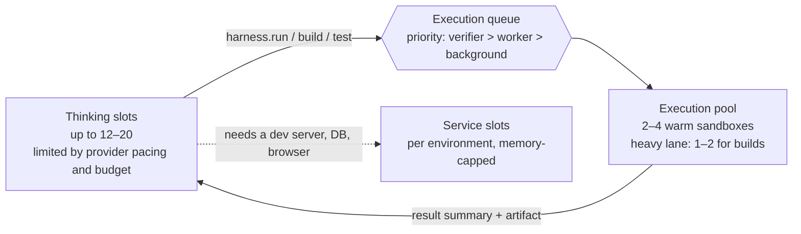

# Execution capacity: many workers without melting the laptop

Wrapped mode ([sandbox and security](sandbox-and-security.md#foreign-agents-native-tools-or-ours)) keeps each foreign agent's whole process tree inside a sandbox for its entire session. The cockpit plans for up to 20 workers, and a foreign CLI costs 0.3–0.6 GB before it runs a single test ([hardware governor](app-shell-and-governor.md#hardware-governor)). Twenty of those would waste 6–12 GB while they mostly wait on model responses, and creating, resetting and scanning twenty sandboxed folders can saturate the disk. This document separates *thinking* from *executing* so a 16 GB Windows laptop stays responsive. Research: [sandbox capacity on Windows](research/sandbox-capacity-on-windows.md).

## First, what actually costs resources

| Isolation | What it is | Fixed cost per sandbox | Where the real cost is |
|---|---|---|---|
| Tier A · MXC | Native process isolation | Small (no virtual machine); to be measured | The processes inside it |
| Tier B · sandbox users | Restricted token under a separate local user | Small (logon session) | The processes inside it |
| Tier C · restricted token | Token and ACLs | Negligible | The processes inside it |
| Tier D · WSL2 / Docker | **One** shared Linux VM; containers inside it | The VM itself, which may grow to 50% of RAM by default | VM memory plus processes |
| Own worker loop | A conversation held by the daemon | Tens of MB per thinking worker | Only while its commands execute |

So twenty sandboxes aren't twenty virtual machines. The waste comes from **process trees that stay alive while their agent is only thinking**, and from **file-system storms** when many sandboxed folders are created or reset at once.

## Decisions in plain words

1. **Three separate pools.** *Thinking slots* (an attempt waiting on or streaming a model response) are cheap and wide. *Execution slots* (sandboxed commands running) are few and warm. *Service slots* (dev servers, databases, browsers per environment) are capped by memory.
2. **Runtimes are classed by what they cost while thinking.** Runtimes that sandbox per command (our loop, Codex) can run wide. Runtimes that keep a process tree per session have their own small cap, always below our loop's width.
3. **Commands queue for a warm execution pool** of 2–4 reusable sandboxes instead of each worker owning one.
4. **No per-file permission storms.** Worktree slots get their permissions once, when created empty, and are reused; `node_modules` comes from a shared read-only package store.
5. **The governor also watches disk activity and UI responsiveness,** and shrinks execution width before the mouse stutters.
6. **Remote execution (Tier E) is designed as an interface now and built later.**

## Three pools

| Pool | Holds | Width set by | 16 GB default (provisional) | 32 GB default (provisional) |
|---|---|---|---|---|
| Thinking | Attempts waiting on a model | Provider pacing, budget, crew plan | Up to 12 | Up to 20 |
| Execution | Sandboxed commands, tests, type checks | Governor (memory, CPU, disk, UI latency) | 2 | 4 |
| Heavy lane (inside execution) | Builds and full type checks | Governor | 1 | 2 |
| Session-process runtimes | Wrapped foreign agents that keep a process tree per session | Governor; always below thinking width | 2 | 5 |
| Services | Dev servers, embedded databases, test browsers, App preview | Governor | 2 environments + preview | 4 environments + preview |

Defaults are replaced by the measured values from the benchmark below.

## Runtimes by cost while thinking

| Runtime | While thinking | While executing | Class |
|---|---|---|---|
| Our worker loop | A conversation in the daemon (tens of MB) | Each command in a pooled sandbox | **Light** |
| Codex models through Sign in with ChatGPT or an API key | Our worker loop drives them (model mode) | Each command in a pooled sandbox | **Light** |
| Codex app-server as a foreign agent | One app-server process may host several threads (to confirm in the spike); Codex's own sandbox runs per command | Per command | **Light** if multiplexing is confirmed, otherwise session-process |
| Copilot SDK, Cursor SDK (wrapped, the default) | The SDK's agent process tree lives in its sandbox for the session | Inside the same sandbox | **Session-process** |
| Copilot SDK, Cursor SDK (stripped) | Agent process outside the sandbox; commands through `harness.run` | Per command, pooled | Session-process for memory; light on sandboxes |
| Claude Code, Gemini CLI, OpenCode (wrapped) | One full process tree per session, inside its sandbox | Inside the same sandbox | **Session-process** |
| Any foreign agent in stripped mode | Its process outside the sandbox (0.3–0.6 GB) | Commands through the pool | Session-process (memory) but light on sandboxes |

**Crew planning** ([planning and crew](planning-and-crew.md#choosing-how-many-workers)) fills thinking width with light runtimes first. Session-process runtimes are scheduled only up to their cap; beyond it, those tasks go to a light runtime with the same model where possible, or wait.

## The execution pool

- **Warm sandboxes.** The pool keeps 2–4 sandbox instances ready (an MXC environment, a sandbox-user logon session or a container), reusing them between commands. Each command gets its own nested Job Object inside the instance, so leftovers die with the command.
- **Binding to a worktree.** A pooled instance is bound to the requesting attempt's worktree slot for one command, with that attempt's network policy and environment. Between commands it carries nothing over: temp folders are wiped, processes are gone.
- **Queue.** Priority: clean verifiers, then worker commands, then background work, with fairness per attempt. The card shows “Waiting for a run slot · 2 ahead” in the Board, and the Office character waits by the machine room.
- **Wrapped agents count as permanently executing.** A session-process runtime holds one execution-capable sandbox for its whole life, which is why its cap exists.

## No permission or antivirus storms

| Measure | Detail |
|---|---|
| Permissions once, at creation | A worktree slot's folder gets its inheritable access entry while still empty; everything checked out or installed later inherits it at creation, so no pass over thousands of files ever runs |
| Reuse, not recreate | Resetting a slot for the next attempt is `git checkout` plus clean inside it, with no permission changes ([hardware governor](app-shell-and-governor.md#disk)) |
| Shared read-only package store | `node_modules` is hard-linked from pnpm's store, which has one inheritable read-only entry for the sandbox identity, set once. Hard links share one file, so sandboxed processes must not write there: `node_modules` is read-only inside the sandbox (this also protects the store from corruption), and tool caches are redirected to the attempt's temp folder |
| One disk lane | Slot creation, dependency installs and template database builds run one at a time, pre-warmed in idle time |
| Dev Drive | Recommended for worktrees, the package store and blobs. A trusted Dev Drive runs Defender in performance mode (scan after open, asynchronously) while keeping real-time protection on |
| Antivirus exclusions | Never added by the harness. Setup explains the trade-off and the developer decides |
| MXC policy | The spike checks whether MXC grants need any file-system writes; policy-based grants are preferred |

## Governor additions

| Signal | Use |
|---|---|
| Disk active time and queue length | Above 80% for 10 s: pause the disk lane and stop admitting new execution |
| Antivirus CPU (Defender's service process) | Sustained high: reduce execution width by one; suggest Dev Drive |
| Sandbox launch latency | Rising p95: fewer warm instances, longer reuse |
| **UI responsiveness** | The window reports input-to-paint latency. p95 over 100 ms for 10 s: reduce execution width by one, then services; thinking width is untouched unless memory is short |
| WSL2 VM memory (Tier D) | Counted as one consumer; the harness recommends a memory cap but never edits the developer's WSL settings itself |

## Tier E: remote execution (later)

When a developer wants more parallel builds, dev servers and browsers than a laptop can host, execution can move to a remote target. The interface is defined now so the pools don't assume “local”:

| Requirement | Design |
|---|---|
| Targets | A remote Docker host over SSH, a second machine running a small harness runner, or a cloud sandbox provider |
| Code transfer | Through Git: the attempt's base commit and patches are pushed to the runner; results come back as commits and artifacts |
| Secrets | Never sent unless the developer approves that environment for that target |
| Network policy | Enforced by the runner with the same rules as locally |
| Cost | Recorded in the ledger in `usd` |
| Scheduling | A separate pool with its own width; thinking stays local |

Planned after M6. Nothing in v1 depends on it.

## Benchmark before choosing defaults (part of the sandbox spike)

| Variable | Values |
|---|---|
| Isolation | Tier A (MXC), Tier B (sandbox users), Tier D (WSL2 / Docker), our loop with the execution pool |
| Count | 1, 5, 10, 20 |
| Load | Idle (agents waiting on a model), active (`pnpm test` and a type check on the template app), mixed |
| Machine | 16 GB Windows 11 laptop, NTFS and Dev Drive |

Measured: committed memory and working set, CPU, disk active time, sandbox launch latency (p50, p95), slot reset time, Defender CPU, and **UI input latency p95**. A configuration passes if UI input latency p95 stays under 50 ms and no hard swapping occurs; the provisional defaults above are then replaced by the largest passing widths per RAM class.

## Edge cases

| Situation | Behavior |
|---|---|
| The developer sets 20 workers on a 16 GB laptop | Allowed as thinking width; the cockpit explains that only 2 run commands at once and shows queue times. |
| Every worker wants to build at the same moment | Heavy lane serializes builds; others continue thinking or run light commands. |
| A wrapped agent sits idle for a long time | After a configurable idle period at a safe point, it is parked and its process tree stopped, freeing its sandbox. |
| Tier D VM already uses half the RAM for something else | Its memory counts against admission; execution width shrinks accordingly. |

[Sandbox and security](sandbox-and-security.md) · [Hardware governor](app-shell-and-governor.md#hardware-governor) · [Worker loop](worker-loop.md) · [Test environments](test-environments.md) · [Research](research/sandbox-capacity-on-windows.md)
