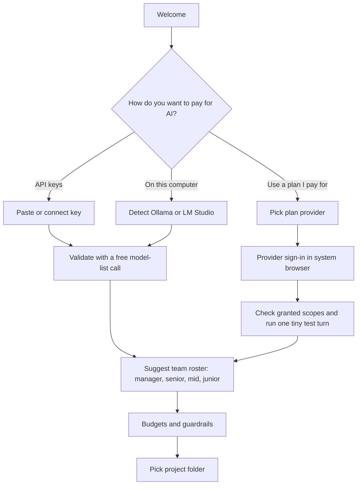

# Provider connections, budgets and plan allowance

How a developer connects AI models on first run and in Settings, how the harness pays for work, and how it paces parallel workers when the limit is a subscription allowance instead of dollars. Research and sources: [provider subscription research](research/provider-subscriptions.md). How the harness drives another company's agent (Codex, Claude Code, Copilot, Cursor): [agent runtime adapters](agent-runtime-adapters.md).

## Decisions in plain words

1. **Three ways to pay, one screen.** *Pay per token* (API keys), *use a plan I already pay for* (subscriptions), and *run on this computer* (local models). A project can mix them, for example juniors on a local model and seniors on a ChatGPT plan.
2. **Plans connect only through the provider's official route.** The harness never copies tokens out of another app's files, never pretends to be another client and never asks for a password. If a provider forbids third-party use of its consumer plan, the harness says so and offers that provider's API key instead.
3. **A plan is not an API key.** “Sign in with ChatGPT” spends the user's ChatGPT plan allowance (Plus/Pro), not per-token API prices. OAuth flows that *mint an API key* (OpenRouter's “Continue with OpenRouter”) are pay-per-token. The UI labels each connection with what it spends.
4. **Two currencies, one reservation rule.** API work reserves dollars. Plan work reserves *allowance*: a share of the plan's usage window that the user lets the harness spend. Both use the same atomic reservation in [coordinator-and-recovery.md](coordinator-and-recovery.md).
5. **No silent paid fallback.** When a plan runs out, work pauses and saves itself. It moves to a paid connection only if the user turned that on in advance, with a dollar cap.
6. **Two shapes of plan route.** OpenAI's plan gives us a *model* (we run our own worker loop). Copilot, Cursor and Gemini CLI plans only work inside *their own agent*, so our harness supervises that agent ([agent runtime adapters](agent-runtime-adapters.md)). Anthropic has no plan route: Claude is used with an API key, in our loop or in Claude Code. The user doesn't need to know which shape is used; the tile says what it spends.

## Why plans matter: $20 of plan is not $20 of API

The concern is real and the numbers support it. Providers publish no token quota for plans, but independent measurements of full Codex use put a $20 ChatGPT Plus plan at roughly **$210–285 of API-equivalent usage a month (about 11–14×)**, and Claude Pro estimates are higher still. One developer priced 30 days of real Codex use on a $100 plan at $745 of API rates. These are workload-dependent estimates, not guarantees ([research](research/provider-subscriptions.md#plan-value-versus-api-prices)).

So the question “does connecting my subscription burn API money?” has a different answer per route:

| Route | Spends | Value |
|---|---|---|
| Sign in with ChatGPT (plan scope) | ChatGPT plan allowance | Plan economics (the good deal) |
| Copilot / Cursor / Claude Code / Gemini CLI login | That product's plan allowance | Plan economics, inside their agent |
| “Continue with OpenRouter” | A real API key billed per token from OpenRouter credits | API economics |
| Pasted API key | Per token | API economics |

The harness shows this column on every tile so nobody connects OpenRouter believing it uses their ChatGPT plan.

## v1 provider matrix

Top five plus OpenRouter and local. Policies change; the matrix lives in a versioned *provider policy file* that ships with app updates so a route can be disabled without a code change.

| Provider | Pay per token | Plan route the harness uses | What the plan spends | Who runs the agent loop |
|---|---|---|---|---|
| OpenAI | API key | **Sign in with ChatGPT** with the plan-usage scope `chatgpt.tokens.use.direct`. OAuth 2.0 + PKCE in the system browser. | Plus/Pro “ChatGPT Work and Codex usage”. The user sets a weekly cap for this app (10–100%) in ChatGPT settings. Plus also shares a five-hour window across every app. | **Our own worker loop** over the Responses API (preferred), or Codex app-server with the same token. |
| GitHub Copilot | BYOK through Copilot SDK (optional) | GitHub OAuth (device flow) → user token → Copilot SDK. Or reuse an existing `copilot` CLI login. | The user's Copilot plan allowance (premium requests). | Copilot's agent runtime (foreign harness). |
| Cursor | — (Cursor is an agent, not a raw model API) | `Cursor.auth.login()` browser login mints a 90-day user key, or the user pastes a dashboard key → `@cursor/sdk` local agent. | The user's Cursor plan usage pool, then on-demand usage if the user enabled it. | Cursor's agent runtime. |
| Anthropic | Claude Console API key (own loop, or Claude Code with the key) | **No plan route in v1.** Anthropic's terms (clarified February 2026) reserve subscription OAuth for Claude Code and claude.ai and forbid third-party developers to collect, store or intermediate those credentials, so the harness neither stores Claude subscription tokens nor drives a plan-logged-in `claude` for automated workers. The developer can still use Claude Code themselves beside the harness ([editor coexistence](editor-coexistence.md)). Revisited if Anthropic explicitly permits it. | — | Claude Code runtime with an API key. |
| Google | Gemini API key (AI Studio) or Vertex | **No third-party plan login, ever.** Google suspends accounts whose Gemini CLI or Antigravity login is reused by another tool. Allowed alternative: the user's own installed, unmodified Gemini CLI, signed in through its own Google login, driven over its official ACP mode (`gemini --acp`), the way the Zed editor hosts it. Off by default; shows a policy notice. Antigravity itself is not offered. | Google AI Pro/Ultra quota (Gemini CLI's daily limits). | Gemini CLI runtime (foreign harness). |
| OpenRouter | “Continue with OpenRouter” OAuth PKCE mints a user key, or paste a key | — | User's OpenRouter credits, per token. | Our own loop. |
| Local | Ollama / LM Studio OpenAI-compatible endpoint | — | This computer's GPU/CPU time. | Our own loop. |

**Owner decisions (16 November 2026):** the harness ships first as an **open-source app that runs locally**, so ChatGPT plan usage is self-serve. A later paid or hosted edition would need OpenAI's interest form. Running Claude Code inside the product requires accepting Anthropic's Commercial Terms. The **Gemini CLI route ships in v1, switched off by default** with a policy warning. **Update (17 November 2026):** the Claude Code *plan* route is withdrawn; Claude is used with Claude Console API keys only (see the Anthropic row above). See [the research note](research/provider-subscriptions.md#what-this-means-for-distribution).

## First-run flow

**Screen 1 · How do you want to pay for AI?** Three cards with one sentence each, plus “You can add more later.” A developer who already pays for ChatGPT, Copilot or Cursor sees those first.

**Screen 2 · Pick a provider.** Each tile carries an honest badge:

- “Uses your ChatGPT Plus/Pro allowance · No API bill”
- “Uses your Copilot plan” · “Uses your Cursor plan”
- “Claude: API key, or your installed Claude Code (see note)”
- “Gemini: API key, or your installed Gemini CLI (see note). Google doesn't allow apps to sign in to Gemini plans.” with a button **Use a Gemini API key instead**.

**Screen 3 · Connect.** One flow per connection type:

| Type | What the user does | What the harness does |
|---|---|---|
| API key | Pastes a key into a masked field. | Detects the provider from the prefix (`sk-ant-`, `sk-or-v1-`, `sk-proj-`, `AIza`). Validates with a model-list call that generates no tokens. Stores it in the OS credential vault. Offers a link to set a spend limit in the provider console. |
| Continue with OpenRouter | Approves in the browser. | PKCE with a loopback callback `http://127.0.0.1:<port>/callback`, exchanges the code for a user key and suggests setting a credit limit on that key. |
| Continue with ChatGPT | Signs in, names the agent, approves “use your ChatGPT plan”, optionally sets the weekly share. | Persists a stable `ext_agent_host_id` before the first sign-in, runs OAuth PKCE + OpenID Connect, verifies the ID token and checks that `chatgpt.tokens.use.direct` was granted. Without it, the sign-in remains but plan usage is marked disabled and the screen offers retry or an API key. |
| GitHub Copilot | Enters a short code at github.com/login/device, or picks “Use my existing Copilot CLI login”. | Stores the GitHub token in the vault, opens one tiny SDK session to confirm a Copilot entitlement and lists models. |
| Cursor | Signs in through the Cursor website. | `Cursor.auth.login()` mints a user key and records its expiry. A reminder appears seven days before it expires. |
| Claude Code (installed) | Pastes a **Claude Console API key** (stored in the vault). | Detects `claude` on PATH and its version, links to the official installer if missing, never reads its credential files or plan login, and confirms with one tiny headless turn using the key. Claude plan logins aren't used by the harness (Anthropic's terms). |
| Gemini CLI (installed) | Clicks **Sign in to Gemini CLI**; a visible terminal runs `gemini` so its own “Sign in with Google” page opens. | Detects `gemini` and its version, never reads `~/.gemini` credentials, starts `gemini --acp` and confirms with one tiny turn. Shows Google's rule in plain words: “Your login stays inside Gemini CLI. If you reuse it elsewhere, Google may suspend your account.” |
| Local | Nothing, if Ollama is running. | Reads `GET /api/tags`, lists models, and flags missing tool-calling support or a small context window. |

The guide panel beside each sign-in shows the steps the user will see on the provider's page (“1 Sign in · 2 Approve *Use your ChatGPT plan* · 3 Optional: choose how much of your weekly usage this app may use; we suggest 50%”). It also shows what to do if the provider page shows an error.

**Screen 4 · Your team.** The harness proposes a roster from the connected models (see [planning and crew](planning-and-crew.md#crew-composition)): *Manager* for planning and integration, *Senior*, *Mid* and *Junior* workers. Each slot names a connection, model and reasoning effort. Defaults are fine; the slot is editable.

**Screen 5 · Budgets and guardrails.**

- Project budget in dollars for pay-per-token connections (default from settings, e.g. $10).
- **Plan share** per plan connection: “The harness may use up to **50%** of my weekly ChatGPT allowance and leave the rest for me.”
- **Paid fallback** off by default. When on: “If my plans run out, continue on *OpenRouter* up to **$5**.”
- Alerts at 50%, 80% and 95%.
- Data policy: allow remote models, or local only.

Then the folder picker ([workspace and git](workspace-and-git.md)).

## Settings → Connections

| Column | Example |
|---|---|
| Label | “ChatGPT (personal)”, “OpenRouter (work)” |
| Type and account | Plan · ChatGPT Pro · ayush@… |
| Status | Healthy · Needs sign-in · Key expires in 5 days · Limit reached until 14:05 · Rejected by provider |
| Spends | “Plan allowance” or “Pay per token” |
| Usage this week | “~18% of weekly share (estimated)” or “$3.42” |
| Roles | Manager, Senior |

Actions: **Add**, **Test**, **Rename**, **Reconnect**, **Rotate key**, **Edit limits**, **Disable** (keeps the secret; routing skips it), **Remove** (revokes where the provider supports it, deletes the secret, and re-routes or holds tasks that used it) and drag to change fallback order. The same provider can appear more than once (personal and work), each with its own ledger.

**Model roster.** A table of tier → connection, model, effort, and a fallback chain per tier. A rule prevents routing to a paid connection unless paid fallback allows it. Changing the roster mid-build affects new attempts only.

## Usage and billing

- **Top-bar meter** while building: dollars for paid connections (“$3.42 of $10”) and allowance bars for plans (“ChatGPT share 18% · five-hour window resets 14:05” when observable).
- **Usage page**: group by project, feature, task, agent, model, connection or day. Input, cached input, output and reasoning tokens. Cost is computed from a versioned price table and labeled *estimated* until reconciled. Export CSV.
- **Per-task receipt**: every model call's tokens, cost or allowance estimate, and duration, linked from the task card.

What each route lets the harness observe:

| Route | Exact tokens | Dollar cost | Remaining plan allowance |
|---|---|---|---|
| API keys (own loop) | Yes, from response usage | Computed from price table. Provider reconciliation needs an admin/usage key (OpenAI, Anthropic) or OpenRouter's key endpoint. | n/a |
| Sign in with ChatGPT | Yes, from response usage | n/a | **Not exposed today** for these tokens. Detected only by a `subscription_sharing_usage_limit_exceeded` error. Link the user to ChatGPT Settings → Usage. |
| Codex app-server with its own ChatGPT login | Yes | n/a | `account/rateLimits/read` returns windows, used percent and reset times. Allowed for local open-source clients; hosted/commercial clients must use Sign in with ChatGPT. |
| Claude Code headless | Per-run usage and cost in the result event | Reported | Only near thresholds (`rate_limit_event`). Full percentages appear only in the interactive status line. |
| Copilot SDK | Per-call input/output tokens and premium-request multiplier; `session.usage.getMetrics` totals | n/a | **Yes**: `account.getQuota` returns used and entitled requests, `remainingPercentage` and `resetDate`. |
| Gemini CLI (ACP) | Per-turn usage where the CLI reports it | n/a | No; detected by quota errors. |
| Cursor SDK | `run.usage` tokens | `Agent.getUsage()` (rolling out for local agents) | Cursor dashboard only. |

Never show a precise remaining-allowance number the provider did not report. Show “estimated” with the basis.

## Budgeting with allowance instead of dollars

**Ledger accounts.** Project → feature → task → attempt, each with limits in one or more currencies: `usd`, `allowance:<connection>` and optional `local-slots`. A reservation must fit every ancestor in every currency it touches, inside one SQLite transaction.

**Converting work into allowance.** Before a call, the kernel estimates tokens (brief + skills + evidence + bounded output). For a plan connection it converts tokens to *allowance points*, the percent of the window the call is expected to burn:

- Where the provider reports used percent (Codex rate limits), learn a factor `k[model]` = Δpercent / tokens with a moving average after each turn, and reserve `tokens × k × 1.3` (safety margin).
- Sign in with ChatGPT rejects `max_output_tokens`, so the harness cannot cap a call's output on that route. Reserve with a per-role worst-case output estimate and settle from the reported usage afterwards.
- Where nothing is reported (Sign in with ChatGPT today), the user's plan share is translated into a **weekly token budget** with a conservative default per plan tier, labeled as an estimate. The user can adjust it. The real stop signal is the provider's limit error.

**Pacing so workers don't all hit the wall at once.** One controller per plan connection, living in the **global resource broker** (not in a project), because two projects can share one plan. Order of operations: the broker's controller decides capacity and issues a grant → the project coordinator deposits it → the coordinator reserves locally against it → the worker is dispatched ([projects, portability and sync](projects-portability-and-sync.md#running-several-projects-at-once)). The controller:

1. **Concurrency by AIMD** (the TCP rule): start at 2 parallel sessions, add one after a run of successful turns without throttling, halve on a throttle and wait for the retry hint. A cap from the user and the plan tier applies.
2. **Burn-rate target**: allowed rate = remaining share ÷ time until the window resets. If the projection says the share runs out before the planned finish, the scheduler slows that connection, moves *junior* tasks to another allowed connection, and shows the new ETA.
3. **Two different stops.** A transient 429 is backoff and does not count as a worker failure. A usage-limit error closes the window: tasks on that connection checkpoint and show “Waiting for allowance · resumes ~14:05” or “Waiting for allowance · check ChatGPT settings” when the reset time is unknown. Work resumes automatically at reset if the user enabled it.

**Local models** use slots, not money: one or two concurrent sessions sized to VRAM, and an estimate of time per task from tokens/second.

## Security rules

- Keys, refresh tokens and OAuth secrets live in the OS credential vault (Windows Credential Manager/DPAPI). SQLite stores only a vault reference.
- Access tokens stay in memory, refresh on schedule and rotate refresh tokens where the provider issues new ones.
- Secrets never enter worktrees, prompts, logs or exported files. The redactor masks any vault value in outgoing text.
- Foreign agents receive credentials only through their own login (Claude Code, Copilot CLI) or a per-process environment variable (Codex `ACCESS_TOKEN`, `CURSOR_API_KEY`) scoped to that child process.

## Edge cases

| Situation | Behavior |
|---|---|
| Refresh fails mid-task, or the user disconnects the app in ChatGPT settings | The provider does not notify the app; the next call fails. Hold tasks on that connection at their boundary, show **Reconnect ChatGPT**, keep other connections running. |
| Plan downgraded (Pro → Plus) | The five-hour window now applies. Reset calibration and lower concurrency. |
| User is also chatting in ChatGPT or Claude while the harness runs | Same plan, shared window. The plan share leaves headroom; the harness relies on the limit error rather than its estimate. |
| Same account on two machines | Estimates drift. Show “estimate may be low: another device uses this plan.” |
| Model disappears from a catalog | Roster falls back to the next entry and notes the change on the plan. |
| Cursor key nearing 90-day expiry | Reminder at seven days; one-click re-login. |
| Provider outage | Mark the connection degraded. Re-route only to connections allowed for that tier and spend type. |
| Key revoked elsewhere | 401 → status “Rejected by provider” with a rotate action. |
| Policy change by a provider | Update the provider policy file. A disabled route parks its tasks and explains why. |

## What to test

- Connect each route on a clean Windows machine. Time to first successful test turn.
- Four workers on one ChatGPT Plus plan: count throttles, time lost and whether the pacing controller avoids hitting the five-hour window before planned work ends.
- Exhaust a plan mid-task: every attempt checkpoints, nothing moves to a paid connection without the pre-authorization, and resume after reset completes the task.
- Users read the spend labels correctly (“plan allowance” vs “pay per token”) in a five-user hallway test.

[Diagram](onboarding-providers-and-runtimes.svg) · [Editable Mermaid](onboarding-providers-and-runtimes.mmd) · [Agent runtime adapters](agent-runtime-adapters.md) · [Coordinator and recovery](coordinator-and-recovery.md) · [Budget stops and resume](stops-undo-and-reentry.md) · [Research](research/provider-subscriptions.md)
